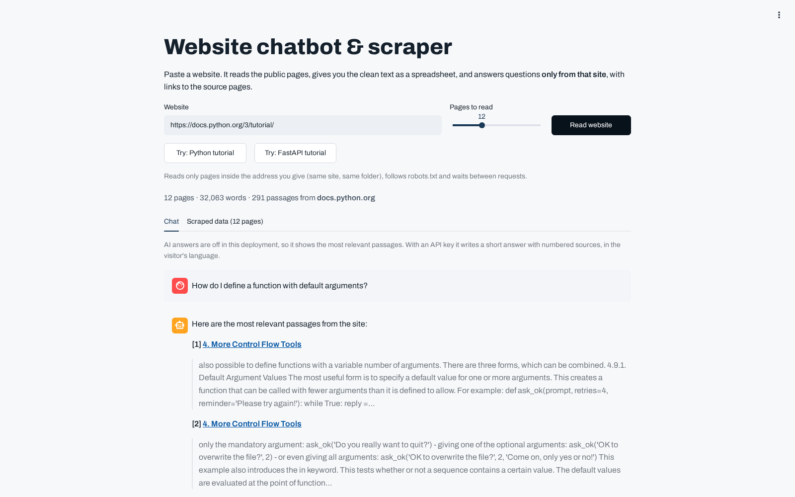

# Website chatbot & scraper

Answers only from the content, with citations.

**Live demo:** https://slimanechanchoul.com/chatbot/ · Streamlit app (may take a minute to wake): https://slimaneoptic-chatbot.streamlit.app

Demo on sample data.

Tests: `pytest -q tests`

Paste a website or upload PDFs. It answers questions **only from that content** with sources, extracts the fields you name into a table, and gives you the clean text as CSV or JSON.



## Features
- **Chat with PDFs:** text-based PDFs, cited as "file.pdf, page N".
- **Extract a table:** type the fields you want ("product, price, in stock"); the AI returns one validated row per item, with the source page.
- **Polite crawler:** stays inside the given site and folder, follows robots.txt, waits between requests, and caps page size.
- **Safe for a public demo:** refuses private or internal network addresses, re-checked on every redirect.
- **Clean extraction:** main text only (menus, footers and ads removed) via trafilatura.
- **Search:** passages ranked with BM25+, which works on small sites too.
- **Answers (with an API key):** an AI model (Gemini 3.8 Flash via OpenRouter, first words in ~1 s) streams a short answer, cites the passages it used, and says so when the site doesn't cover the question. If OpenRouter fails or runs out of credit, Claude Haiku 5.5 (Anthropic API) takes over, then free models.
- **Without a key, or when every model is busy:** shows the most relevant passages with source links.
- **Export:** CSV and JSON of every page read.

## Run locally
```bash
pip install -r requirements.txt
export OPENROUTER_API_KEY=your-key   # optional
export ANTHROPIC_API_KEY=your-key    # optional: Claude Haiku 5.5 as the backup
streamlit run app.py
pytest -q tests
```
Optional: `OPENROUTER_MODELS="model-a,model-b"` overrides the model list (default: Gemini 3.8 Flash, then free backups; see `llm.py`).
With `ANTHROPIC_API_KEY` set, Claude Haiku 5.5 is tried after the paid models and before the free ones, and backs up the small extras (search translation, starter questions). `ANTHROPIC_DAILY_CAP` (default 1.00 USD a day per server instance) is a hard cap on its spend, counted from each answer's token usage.

## Need this for your business?
An assistant for your website, help center or PDFs, with an embeddable chat widget, lead capture, WhatsApp or email handoff, scheduled re-indexing, and reports on unanswered questions. https://www.upwork.com/freelancers/~01d6ae0f1a06a43ac0
